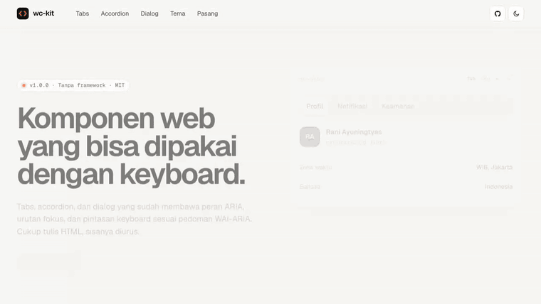
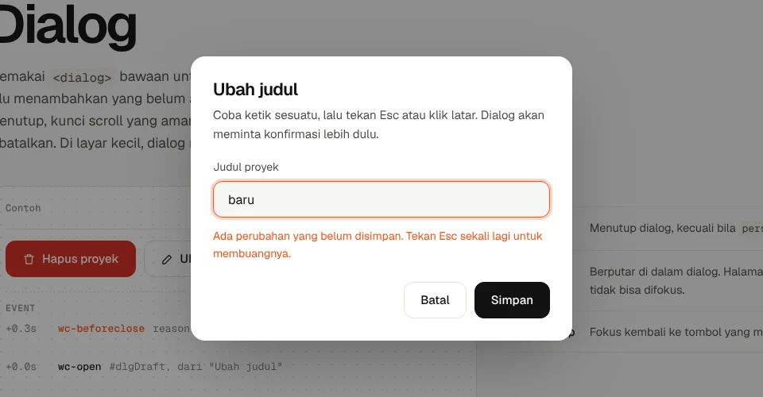
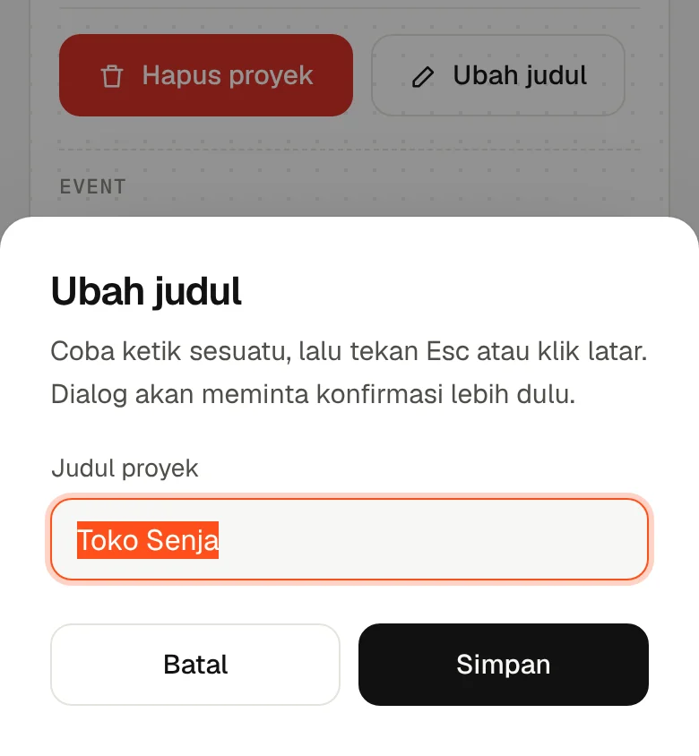
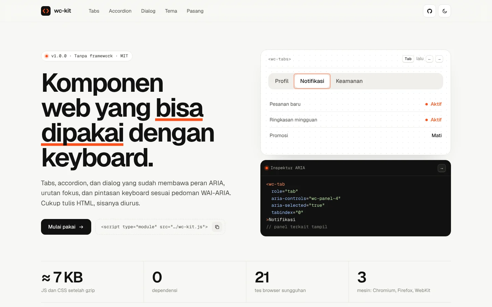
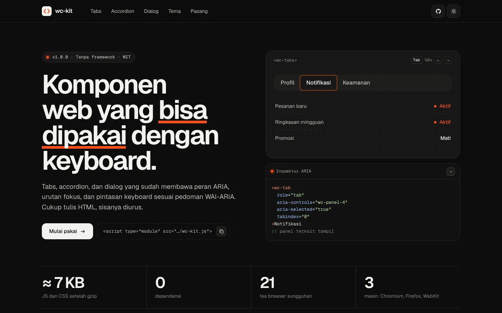

# wc-kit

[](https://github.com/rezaaryam/wc-kit/actions/workflows/test.yml)


Tabs, accordion, dan dialog sebagai komponen web yang **bisa dipakai dengan keyboard dan pembaca layar**. Peran ARIA, urutan fokus, dan pintasan keyboard sudah terpasang sesuai [WAI-ARIA Authoring Practices](https://www.w3.org/WAI/ARIA/apg/). Cukup tulis HTML. Tanpa framework, tanpa dependensi, sekitar 7 KB.

**[Buka dokumentasi dan demo](https://rezaaryam.github.io/wc-kit/)**



Panel hitam di demo adalah **Inspektur ARIA**: ia menampilkan atribut ARIA elemen yang sedang difokus dan tombol yang baru ditekan, jadi Anda bisa melihat apa yang "didengar" pembaca layar.

## Pakai dalam satu menit

```html
<link rel="stylesheet" href="https://rezaaryam.github.io/wc-kit/wc-kit.css">
<script type="module" src="https://rezaaryam.github.io/wc-kit/wc-kit.js"></script>

<wc-tabs label="Produk">
  <wc-tab>Deskripsi</wc-tab>
  <wc-tab>Ulasan</wc-tab>
  <wc-panel>...</wc-panel>
  <wc-panel>...</wc-panel>
</wc-tabs>
```

Atau salin `src/wc-kit.js` dan `src/wc-kit.css` ke proyek Anda. Bisa dipakai di HTML biasa, PHP, WordPress, maupun di dalam React dan Vue.

## Komponen

### `<wc-tabs>`

```html
<wc-tabs label="Laporan" selected="0">
  <wc-tab>Ringkasan</wc-tab>
  <wc-tab>Pendapatan</wc-tab>
  <wc-tab disabled>Arsip</wc-tab>
  <wc-panel>...</wc-panel>
  <wc-panel>...</wc-panel>
  <wc-panel>...</wc-panel>
</wc-tabs>
```

| Atribut | Gunanya |
|---|---|
| `label` | Nama daftar tab untuk pembaca layar. |
| `selected` | Indeks tab aktif, ikut berubah saat pengguna memilih. |
| `activation="manual"` | Panah hanya memindah fokus, pilih dengan Enter atau Spasi. |
| `orientation="vertical"` | Daftar tab di samping, navigasi dengan panah atas dan bawah. |
| `disabled` pada `wc-tab` | Tab tampil tetapi tidak bisa dipilih, dilewati oleh panah. |

Keyboard: <kbd>←</kbd> <kbd>→</kbd> pindah tab (berputar di ujung), <kbd>Home</kbd> <kbd>End</kbd> ke ujung, <kbd>Tab</kbd> masuk ke panel.
API: `select(i)`, `selectedIndex`, event `wc-change` dengan `detail: { index, tab, panel }`.

### `<wc-accordion>`

```html
<wc-accordion single>
  <details open>
    <summary>Apakah perlu framework?</summary>
    <div>Tidak.</div>
  </details>
  <details>
    <summary>Bagaimana bila JavaScript mati?</summary>
    <div>Tetap bekerja sebagai details biasa.</div>
  </details>
</wc-accordion>
```

Dibangun di atas `<details>`, jadi tetap bekerja walau JavaScript gagal dimuat. Komponen menambahkan animasi tinggi, `single` (satu terbuka), dan navigasi <kbd>↑</kbd> <kbd>↓</kbd> <kbd>Home</kbd> <kbd>End</kbd> antarjudul.
API: `toggle(i, paksa?)`, `open(i)`, `close(i)`, event `wc-toggle` dengan `detail: { details, open, index }`.

### `<wc-dialog>`

```html
<button data-wc-open="hapus">Hapus proyek</button>

<wc-dialog id="hapus">
  <h2>Hapus proyek ini?</h2>
  <p data-wc-desc>Semua berkas ikut terhapus.</p>
  <button data-wc-close="batal">Batal</button>
  <button data-wc-close="hapus">Hapus</button>
</wc-dialog>
```

Memakai `<dialog>` bawaan untuk lapisan atas dan isi halaman yang tidak bisa disentuh, lalu menambahkan yang belum ada:

- fokus kembali ke tombol pembuka setelah ditutup,
- klik latar untuk menutup, atau `persistent` bila langkahnya wajib diselesaikan,
- kunci scroll halaman, termasuk di iPhone,
- animasi keluar, bukan hilang mendadak,
- tampil sebagai lembar dari bawah di layar kecil (tambahkan `center` bila ingin tetap di tengah),
- event `wc-beforeclose` yang bisa dibatalkan, misalnya saat ada isian yang belum disimpan.

```js
dialog.addEventListener("wc-beforeclose", (e) => {
  if (formBelumDisimpan && e.detail.reason !== "simpan") e.preventDefault();
});
```

API: `show()`, `close(alasan)`, `toggle()`, `isOpen`, event `wc-open`, `wc-beforeclose`, `wc-close` dengan `detail.reason` berisi `escape`, `backdrop`, `button`, nilai `data-wc-close`, atau `api`.

<table>
  <tr>
    <td width="60%"></td>
    <td></td>
  </tr>
</table>

## Tema

Tidak ada kelas yang perlu ditimpa. Ubah variabel CSS:

```css
wc-tabs, wc-accordion, wc-dialog {
  --wc-accent: #2563eb;
  --wc-radius: 8px;
  --wc-duration: 200ms;
  --wc-surface: #fff;
  --wc-surface-2: #f4f4f1;
  --wc-border: #e3e2dc;
  --wc-ink: #141414;
  --wc-ink-2: #5c5c58;
}
```

Semua animasi berhenti bila perangkat meminta gerak dikurangi (`prefers-reduced-motion`).

| Terang | Gelap |
|---|---|
|  |  |

## Keputusan desain

- **HTML dulu.** Komponen memperkaya markup yang sudah bermakna. Sebelum skrip jalan, semua panel tabs tampil berurutan dan accordion tetap bisa dibuka.
- **Light DOM, bukan Shadow DOM.** Isi komponen tetap bisa diatur dengan CSS halaman, dicari dengan Ctrl+F, dan dibaca mesin pencari.
- **Pakai yang sudah disediakan browser.** `<dialog>` untuk lapisan atas dan inert, `<details>` untuk buka-tutup. Kode tambahan hanya untuk yang belum ada.
- **Diuji di browser sungguhan.** Tes menekan tombol keyboard dan mengeklik seperti pengguna, lalu memeriksa fokus dan atribut ARIA, di Chromium, Firefox, dan WebKit.

## Pengembangan

```bash
npm install
npx playwright install chromium   # sekali saja
npm test                          # 21 tes browser + 2 tes konsistensi
BROWSER=webkit npm test           # mesin Safari (perlu: npx playwright install webkit)
npm start                         # dokumentasi di http://localhost:3000
npm run sync                      # salin src/ ke docs/ setelah mengubah pustaka
```

```
src/wc-kit.js     pustaka (ES module, ±19 KB, ±5,5 KB gzip)
src/wc-kit.css    tema dasar (±1,9 KB gzip)
docs/             situs dokumentasi, disajikan GitHub Pages
test/             tes Playwright dan fixture
```

## Lisensi

Kode: MIT © Reza Arya Maulana. Huruf Geist di `docs/fonts/` memakai SIL Open Font License.
